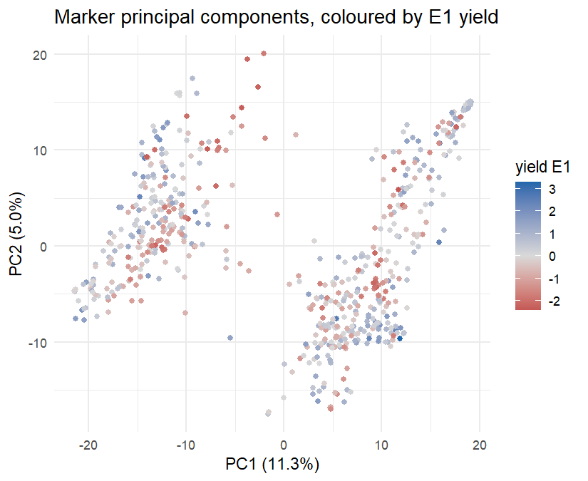

# How well do DNA markers predict wheat grain yield?

[](https://github.com/Olaraym/wheat-genomic-prediction/actions/workflows/ci.yml)

**Question.** How accurately can genome-wide markers predict the grain yield of untested wheat lines, which model
family does it best, and does modelling genotype × environment (G×E) interaction help?

**Why it matters.** Genomic prediction lets breeders rank new lines from DNA alone, before costly multi-environment
yield trials. Its value depends on how accurate the predictions are and under which conditions.

**Status:** Week 1 of 4 complete (Nov 2026): data checked and the published benchmark reproduced. Full plan:
[P1 analysis plan](docs/PLAN.md).

## Data

CIMMYT historical bread wheat lines, shipped with the BGLR R package (`data(wheat)`); used by
[Crossa et al. (2010)](https://pmc.ncbi.nlm.nih.gov/articles/PMC2954475).

| Object | Contents |
| --- | --- |
| Yield | 599 lines × 4 mega-environments (E1–E4), already standardized to mean 0, variance 1 per environment |
| Markers | 1,279 DArT markers coded 0/1 |
| Pedigree | 599 × 599 additive relationship matrix |
| Folds | the published 10-fold partition |

## Week 1 results

**Data checks** ([`results/00_data_checks.md`](results/00_data_checks.md))

- No missing values; yield is already standardized.
- **96 of 1,279 markers have minor allele frequency below 0.05**, although the documentation says such markers were
  removed. They are kept, to match the benchmark; their effect is tested later.
- **Two genetic groups** are visible on the first marker principal component (11.3% of variance): relevant for how
  cross-validation folds are drawn.
- Pedigree and marker relationships agree only moderately (r = 0.27); markers reveal relatedness the pedigree misses.
- Genomic heritability on line means: 0.42–0.50 by environment, so predictive ability can reach at most about 0.65–0.71.



**Benchmark reproduced** ([`results/01_validation.md`](results/01_validation.md))

Mean predictive ability (correlation between observed and predicted yield of held-out lines) over 10 random 10-fold
cross-validation replicates, against Crossa et al. (2010), Table 3:

| Model | E1 | E2 | E3 | E4 |
| --- | --- | --- | --- | --- |
| Pedigree BLUP, this repo | 0.429 | 0.408 | 0.396 | 0.447 |
| Pedigree BLUP, published | 0.448 | 0.417 | 0.417 | 0.449 |
| Marker BLUP, this repo | 0.529 | 0.496 | 0.389 | 0.454 |
| Marker BLUP, published | 0.480 | 0.488 | 0.355 | 0.464 |

All 8 comparisons fall within the ±0.05 tolerance fixed in advance. Marker BLUP in E1 is borderline (+0.049); the gap
remains on the published fold partition (0.524), so it most likely reflects how the shrinkage was estimated (REML here),
not the folds. GBLUP and marker ridge BLUP gave identical predictions in all 440 fits, as theory requires.

## Reproduce (Windows, macOS or Linux)

1. Install R 4.4 or later from [CRAN](https://cloud.r-project.org).
2. In a terminal, from this folder:

```bash
Rscript install_packages.R                                   # one time
Rscript -e "testthat::test_dir('tests/testthat')"            # 17 checks
Rscript run_all.R                                            # Steps 0-1, about 3-4 minutes
```

On Windows, if `Rscript` is not recognized, use its full path, e.g.
`& "C:\Program Files\R\R-4.5.2\bin\Rscript.exe" run_all.R`.

## Layout

```
R/functions.R                     data loading, relationship matrices, folds, model fits, cross-validation
scripts/00_data_checks.R          Step 0: checks and exploration
scripts/01_reproduce_benchmark.R  Step 1: Crossa et al. (2010) reproduction
tests/testthat/                   unit tests (run on every push by GitHub Actions)
results/                          tables, figures and run logs
```

## Author

Laide A. Rasaki · NC State University · [ORCID 0000-0002-5594-6827](https://orcid.org/0000-0002-5594-6827).
AI assistance is documented in [AI_ASSISTANCE.md](AI_ASSISTANCE.md).
