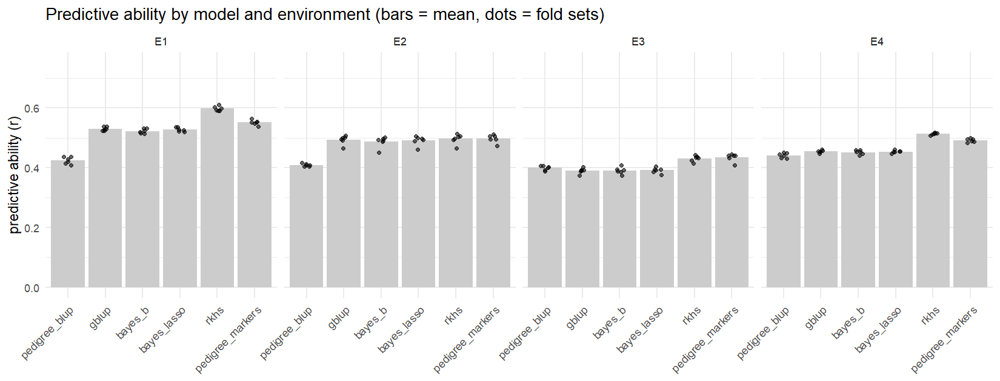

# How well do DNA markers predict wheat grain yield?

[](https://github.com/Olaraym/wheat-genomic-prediction/actions/workflows/ci.yml)

**Question.** How accurately can genome-wide markers predict the grain yield of untested wheat lines, which model
family does it best, and does modelling genotype × environment (G×E) interaction help?

**Why it matters.** Genomic prediction lets breeders rank new lines from DNA alone, before costly multi-environment
yield trials. Its value depends on how accurate the predictions are and under which conditions.

**Status:** Weeks 1–2 of 4 complete (Nov 2026): benchmark reproduced, and six models compared in four environments.
All results reproduced identically on Linux and Windows. Next: multi-environment (G×E) models. Full plan:
[P1 analysis plan](docs/PLAN.md).

**Findings so far**

1. **Yield behaves as a many-small-genes trait.** BayesB and Bayesian LASSO, which allow large single-marker effects,
   are within 0.01 of GBLUP in every environment.
2. **A non-linear marker model (RKHS) predicts best**, beating GBLUP by 0.04–0.07 in three of four environments, in
   every fold set, and matching the RKHS results published for this dataset.
3. **Markers beat pedigree in only two of four environments.** In E3 and E4 the pedigree predicts as well as markers.
4. **Accuracy depends heavily on relatedness.** Predicting one genetic group from the other cuts GBLUP's predictive
   ability by 0.19 on average, compared with random splits of the same size.

## Data

CIMMYT historical bread wheat lines, shipped with the BGLR R package (`data(wheat)`); used by
[Crossa et al. (2010)](https://pmc.ncbi.nlm.nih.gov/articles/PMC2954475).

| Object | Contents |
| --- | --- |
| Yield | 599 lines × 4 mega-environments (E1–E4), already standardized to mean 0, variance 1 per environment |
| Markers | 1,279 DArT markers coded 0/1 |
| Pedigree | 599 × 599 additive relationship matrix |
| Folds | the published 10-fold partition |

## Week 1 results

**Data checks** ([`results/00_data_checks.md`](results/00_data_checks.md))

- No missing values; yield is already standardized.
- Weeks 1 and 2 reproduced identically on Linux and on Windows (same seeds, same numbers to three decimals).
- **96 of 1,279 markers have minor allele frequency below 0.05**, although the documentation says such markers were
  removed. They are kept, to match the benchmark; their effect is tested later.
- **Two genetic groups** are visible on the first marker principal component (11.3% of variance): relevant for how
  cross-validation folds are drawn.
- Pedigree and marker relationships agree only moderately (r = 0.27); markers reveal relatedness the pedigree misses.
- Genomic heritability on line means: 0.42–0.50 by environment, so predictive ability can reach at most about 0.65–0.71.


**Benchmark reproduced** ([`results/01_validation.md`](results/01_validation.md))

Mean predictive ability (correlation between observed and predicted yield of held-out lines) over 10 random 10-fold
cross-validation replicates, against Crossa et al. (2010), Table 3:

| Model | E1 | E2 | E3 | E4 |
| --- | --- | --- | --- | --- |
| Pedigree BLUP, this repo | 0.429 | 0.408 | 0.396 | 0.447 |
| Pedigree BLUP, published | 0.448 | 0.417 | 0.417 | 0.449 |
| Marker BLUP, this repo | 0.529 | 0.496 | 0.389 | 0.454 |
| Marker BLUP, published | 0.480 | 0.488 | 0.355 | 0.464 |

All 8 comparisons fall within the ±0.05 tolerance fixed in advance. Marker BLUP in E1 is borderline (+0.049); the gap
remains on the published fold partition (0.524), so it most likely reflects how the shrinkage was estimated (REML here),
not the folds. GBLUP and marker ridge BLUP gave identical predictions in all 440 fits, as theory requires.

## Week 2 results: single-environment models

Six models, each fitted one environment at a time on the same six fold sets (the published partition plus five random
10-fold sets), so every comparison is paired. Full tables: [`results/02_single_env.md`](results/02_single_env.md).

**Predictive ability** (mean over 6 fold sets; SD across fold sets 0.003–0.018)

| Model | E1 | E2 | E3 | E4 |
| --- | --- | --- | --- | --- |
| Pedigree BLUP | 0.424 | 0.409 | 0.399 | 0.441 |
| GBLUP (reference) | 0.530 | 0.493 | 0.390 | 0.454 |
| BayesB | 0.523 | 0.487 | 0.390 | 0.452 |
| Bayesian LASSO | 0.527 | 0.491 | 0.391 | 0.454 |
| **RKHS (Gaussian kernel)** | **0.598** | **0.497** | 0.431 | **0.514** |
| Pedigree + markers | 0.551 | **0.497** | **0.434** | 0.492 |
| *RKHS, Crossa et al. (2010)* | *0.601* | *0.494* | *0.445* | *0.524* |



**Against GBLUP**, using the rule fixed in advance (|difference| ≥ 0.02 and at least 5 of 6 fold sets agree):

- **H1, markers beat pedigree: partly supported.** GBLUP beats pedigree BLUP in E1 (+0.106) and E2 (+0.084), but not
  in E3 or E4. This fits Step 0, where pedigree-based heritability exceeded marker-based heritability in E3 (0.58 vs.
  0.42) and E4 (0.54 vs. 0.43): the pedigree captures genetic signal that these 1,279 DArT markers miss there.
- **H2, Bayesian models ≈ GBLUP: supported.** BayesB and Bayesian LASSO never differ from GBLUP by more than 0.01.
- **RKHS is better than GBLUP** in E1 (+0.067), E3 (+0.041) and E4 (+0.060), the same in E2. Its Gaussian kernel
  treats genetic similarity non-linearly, so it can capture interactions among loci that an additive model misses.
  Its scores match those published by Crossa et al. (2010) within 0.015, an independent check of the pipeline.
- **Pedigree + markers is better than GBLUP** in E1, E3 and E4 (+0.02 to +0.04): combining the two helps where the
  pedigree carries extra information.

**Correlation and selection can disagree.** In E1, pedigree BLUP has the lowest predictive ability (0.42) but the
highest overlap with the truly top 20% of lines (0.39, vs. 0.31 for GBLUP). The best model overall is not necessarily
the best at picking the top lines, which matters for breeders.

**MCMC convergence** ([`results/02b_convergence.md`](results/02b_convergence.md)): all 16 Bayesian chains pass
(effective sample size ≥ 100, halves agree within 10%). Bayesian LASSO needed twice the iterations to get there.

**Prediction across genetic groups** ([`results/02c_structure.md`](results/02c_structure.md))

The markers split the lines into two groups (253 and 346 lines). Training on one group and predicting the other,
compared with random splits of the same sizes:

| Environment | GBLUP, across groups | GBLUP, random split | Drop | Pedigree, across groups | Pedigree, random split |
| --- | --- | --- | --- | --- | --- |
| E1 | 0.154 | 0.471 | 0.317 | 0.048 | 0.347 |
| E2 | 0.354 | 0.443 | 0.089 | 0.188 | 0.382 |
| E3 | 0.236 | 0.336 | 0.100 | 0.173 | 0.355 |
| E4 | 0.168 | 0.404 | 0.236 | 0.262 | 0.396 |

Across groups, GBLUP loses 0.19 on average and pedigree BLUP 0.20; pedigree prediction in E1 almost vanishes (0.05).
Random cross-validation therefore describes prediction for lines related to the training set. To predict material
from a different breeding group, relatives of that group need to be in the training population.

## Reproduce (Windows, macOS or Linux)

1. Install R 4.4 or later from [CRAN](https://cloud.r-project.org).
2. In a terminal, from this folder:

```bash
Rscript install_packages.R                                   # one time
Rscript -e "testthat::test_dir('tests/testthat')"            # 34 checks
Rscript run_all.R                                            # all steps
```

Week 2's comparison takes about 1.5–2 hours on a 12-thread laptop. Time it first with a short trial:

```bash
Rscript scripts/02_single_env_models.R --quick               # 1 fold set, short chains; prints a projected full run time
Rscript scripts/02b_convergence.R                            # MCMC check, a few minutes
Rscript scripts/02_single_env_models.R                       # full comparison (uses all cores but one, max 10)
Rscript scripts/02c_structure_cv.R                           # under a minute
```

On Windows, if `Rscript` is not recognized, use its full path, e.g.
`& "C:\Program Files\R\R-4.5.2\bin\Rscript.exe" run_all.R`.

## Layout

```
R/functions.R                     data loading, relationship matrices, folds, model fits, cross-validation
scripts/00_data_checks.R          Step 0: checks and exploration
scripts/01_reproduce_benchmark.R  Step 1: Crossa et al. (2010) reproduction
scripts/02_single_env_models.R    Step 2: six-model comparison (parallel; --quick for a timing trial)
scripts/02b_convergence.R         Step 2b: MCMC convergence check
scripts/02c_structure_cv.R        Step 2c: prediction across genetic groups
tests/testthat/                   unit tests (run on every push by GitHub Actions)
results/                          tables, figures and run logs
```

## Author

Laide A. Rasaki · NC State University · [ORCID 0000-0002-5594-6827](https://orcid.org/0000-0002-5594-6827).
AI assistance is documented in [AI_ASSISTANCE.md](AI_ASSISTANCE.md).
